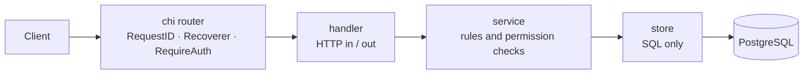

# ticketing-api

[](https://github.com/mujtaba91/ticketing-api/actions/workflows/ci.yml)

A REST API for booking event tickets, written in Go with PostgreSQL.

The core rule: **a seat can never be booked more than once, no matter how many requests arrive at the same time.** An integration test fires 50 concurrent bookings at an event with 10 seats and checks that exactly 10 succeed.

## Run it

Needs Docker.

```sh
make up
```

This copies `.env.example` to `.env`, starts PostgreSQL, runs the migrations and starts the API on the `HTTP_PORT` from `.env`. Interactive API docs are served at `/docs`.

| Command | What it does |
|---|---|
| `make test` | Unit tests |
| `make test-integration` | Integration tests against a real PostgreSQL in a container (needs Docker) |
| `make lint` | golangci-lint, same pinned version as CI |
| `make swagger` | Regenerate `docs/swagger.json` after changing handler annotations |
| `make down` | Stop everything |

## Architecture



The code is organised by feature (`auth`, `organization`, `event`, `booking`), and each feature has the same three layers:

- **handler:** decodes the request and writes the response.
- **service:** validation, business rules and permission checks.
- **store:** SQL only.

Shared pieces are kept small:

- `apperr`: error kinds.
- `httpx`: JSON and the error format.
- `database`: the pool and a transaction helper.

## Roles

- **Admin:** platform-wide.
- **Owner** and **Staff:** members of one organization, who manage only that organization's events. Only the Owner can add Staff.
- **Attendee:** any logged-in user. Books and cancels their own bookings.

## Design decisions

### No double booking: `SELECT ... FOR UPDATE`

Booking runs in one transaction:

1. Lock the event row with `FOR UPDATE`.
2. Count the active bookings.
3. Refuse with 409 if the event is full.
4. Insert the booking.

A second booking for the same event waits at the lock until the first one commits, so the count it sees is always current.

- **Why a row lock and not a conditional update:** a conditional update (`UPDATE events SET booked = booked + 1 WHERE booked < max_seats`) needs a counter column that must be kept in sync with the bookings table. The lock keeps the schema simple.
- **The cost:** bookings for the *same* event run one at a time. Bookings for different events don't block each other.
- **One active booking per user and event:** a partial unique index on `bookings (event_id, user_id) WHERE cancelled_at IS NULL` enforces it. The same index also makes the seat count fast.

### Cancelling does not lock the event

A cancel only frees a seat, so it can never oversell. The worst case is that a booking running at the same moment is refused one moment too early.

Cancel is a single conditional `UPDATE ... WHERE id = $1 AND user_id = $2 AND cancelled_at IS NULL`, so "only your own booking, only once" is checked atomically. Someone else's booking, a missing booking and an already cancelled one all return 404, which reveals nothing about other users' bookings.

### `max_seats` cannot be edited

Shrinking it below the number of existing bookings would oversell the event, so `PATCH /events/{id}` only changes the name and start time.

### Refresh token reuse revokes every session

Refresh tokens rotate: each refresh returns a new token and revokes the old one. If a revoked token is used again, the API assumes it was stolen and increments `users.token_version`. That logs the user out on every device, because both refresh and access tokens carry the version they were issued with.

**Trade-off: access tokens are checked against the database.** `RequireAuth` loads the user on every request to compare `token_version`. That costs one indexed read per request. In return, revocation is instant instead of waiting up to 15 minutes for the access token to expire.

**Trade-off: a retry counts as reuse.** Suppose a client sends a refresh request, the response is lost on the network, and the client retries with the same token. The retry looks exactly like an attacker replaying a stolen token, so the user is logged out and has to sign in again. Some systems accept the old token for a few seconds after rotation to avoid this. This project keeps the strict rule, because a grace period adds state and a window in which a stolen token still works.

### Permissions are checked in the service, per request

The organization role is looked up from the database on each request, not put in the token or the request context. A role change therefore applies immediately.

Admins skip the organization check. A non-member gets 403 rather than 404, because organizations and events are not secret.

### `GET /events` uses keyset pagination, not OFFSET

`?limit=` (default 20, max 100) and `?cursor=`, which is the `next_cursor` from the previous page and is null on the last page. The next page is fetched with `WHERE (starts_at, id) > (cursor) ORDER BY starts_at, id`, served by an index on `(starts_at, id)`.

- **Why not OFFSET:** `OFFSET 10000` reads and throws away 10,000 rows, and an insert or delete between two requests shifts rows so a page skips or repeats one. A cursor always starts exactly after the last row seen.
- **Why `id` in the key:** two events can start at the same time; `id` makes the order unique, so no event is skipped at a page boundary.
- **The cost:** no "jump to page 7", only next. The cursor is base64 so clients treat it as opaque.
- **No count query:** the API fetches `limit + 1` rows; the extra row only tells it whether a next page exists.

### One error format, nothing internal leaks

Every error, including chi's own 404 and 405, has the same shape:

```json
{ "error": { "code": "invalid", "message": "validation failed", "fields": { "email": "is required" } } }
```

Services return typed `apperr` kinds, which map to status codes. Anything else is logged with the request ID and answered with a generic 500.

### Swagger is generated from the handlers

`make swagger` runs swag over the annotations above each handler and writes `docs/swagger.json`. Request and response fields come straight from the Go structs, so they can't go out of date. swag only writes the JSON and YAML files, no Go code, so it isn't a runtime dependency.

Two checks keep the spec honest:

- **CI:** regenerates the spec and fails if it differs from the committed one.
- **A unit test:** walks the router and fails if a route has no annotations.

## Tests

The integration tests in `tests/integration/` run against a real PostgreSQL started with testcontainers. They cover:

- **50 concurrent bookings on 10 seats:** exactly 10 get 201 and 40 get 409, and the database holds exactly 10 active bookings.
- **Staff of org A on an event of org B:** 403. The same Staff user gets 200 on their own org's event, which proves the 403 comes from the org check.
- **Refresh token reuse:** the whole session is revoked, including the newest refresh token and the access token.
- **Two concurrent refreshes with the same token:** exactly one wins, and the winner's token is then revoked too.
- **Paging through events:** 25 events, 20 of them at the same start time, paged 10 at a time: every event appears exactly once and in order.

CI runs `go vet`, golangci-lint, and the unit and integration tests with `-race` on every push.

## Left out on purpose

- **HttpOnly cookies for browser clients:** tokens are returned in the JSON body, which suits API and mobile clients and keeps testing with curl simple.
- **Pagination on the other list endpoints and filtering:** an organization or a user has few rows; `GET /events` is the list that grows.
- **Payments, email, caching and rate limiting:** outside the scope of a booking-correctness demo.
